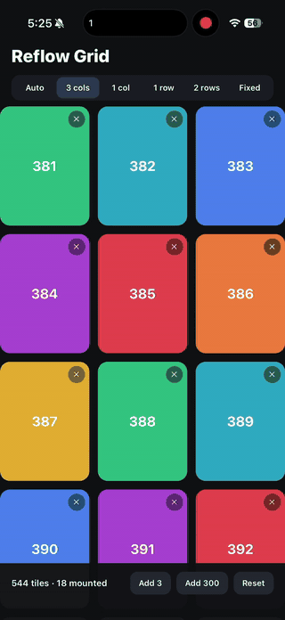

# react-native-reflow-grid

A grid for React Native where **items glide to their new places** when one is added, removed, reordered, or the layout changes — in the spirit of a collection view's updates and Safari's tab overview — while **only the items on screen are mounted**.

- **Windowed.** Off-screen items exist only as slots in the layout; just what's visible (plus a buffer) is mounted.
- **Animated reflow.** Remove an item and it shrinks away while the rest spring into the gap. Change the layout (3 columns → 1, vertical → horizontal) and everything glides.
- **Pluggable layouts.** A layout is just `(data, container) => { size, rectOf, indicesIn }`: it sees the items, so it can depend on their sizes. `gridLayout` covers grids, lists and strips, `masonryLayout` columns of items of any height; write your own for anything else.
- **Drag to reorder.** Hold an item (or drag it with a mouse on web) and the others glide aside to make room. Dragging scrolls at the edges and turns pages. See [Drag to reorder](#drag-to-reorder).
- **Paged layouts.** `pagedLayout` snaps to pages, with page dots you can tap or scrub, as in a home screen.
- **Reliable multi-touch.** Presses are decided by the grid, not by per-item `Pressable`, so a second finger's tap isn't dropped while another finger holds the responder.
- Optional haptic feedback (through `expo-haptics`), reduce-motion support, and vertical, horizontal or two-axis scrolling. iOS, Android and web.

Built on `react-native-reanimated` v4 and `react-native-worklets`. Pure TypeScript — no native code.

## Demo

| Columns | Rows |
| --- | --- |
|  |  |

Drag to reorder, across arrangements:

| 3 columns | 1 column | Masonry |
| --- | --- | --- |
|  |  |  |

| Vertical paging | Horizontal paging |
| --- | --- |
|  |  |

## Install

```sh
npm install react-native-reflow-grid react-native-reanimated react-native-worklets
```

For haptic feedback while dragging, also have [`expo-haptics`](https://docs.expo.dev/versions/latest/sdk/haptics/) (`npx expo install expo-haptics`). It's optional: the grid uses it when it's there, and an app without it bundles and runs as before.

## Usage

```tsx
import { gridLayout, ReflowGrid } from 'react-native-reflow-grid';

const layout = useMemo(() => gridLayout({ flow: 'vertical', lines: 3, gap: 12 }), []);

<ReflowGrid
  style={{ flex: 1 }}
  data={items}
  layout={layout}
  keyExtractor={(item) => item.id}
  renderItem={(item) => <Tile item={item} />}
  touchRegions={(item, { size }) => [
    { key: 'remove', rect: { x: size.width - 40, y: 0, width: 40, height: 40 }, onPress: () => remove(item.id) },
  ]}
/>
```

`renderItem` draws; it takes no touches. It's given `{ index, size, dragging }`; `dragging` is true for an item being dragged (its slot also dims). Pressable parts are declared in `touchRegions` (in the item's own space), and the grid fires `onPress` when a finger that went down inside one lifts without having moved.

Memoize `layout` and `touchRegions`: a new function lays everything out again.

### `gridLayout(options)`

| Option | Description |
| --- | --- |
| `flow` | `'vertical'` fills a row, then the next below. `'horizontal'` fills a column, then the next beside it. |
| `lines` | Columns (vertical flow) or rows (horizontal). |
| `gap` | A number, or `{ x, y }`. Default `0`. |
| `card` | `{ aspect }` (width ÷ height, default `0.75`), `{ length }` (fixed along the scroll axis), or `{ width, height }` (fixed on both; the grid then scrolls on both axes). |

### `<ReflowGrid>` props

| Prop | Description |
| --- | --- |
| `data`, `keyExtractor`, `renderItem` | As in a list. Keys decide who stays, enters and leaves. |
| `layout` | A `ReflowLayout` (see below). Memoize it. |
| `touchRegions` | Pressable parts of an item. |
| `axis` | `'vertical'` (default), `'horizontal'`, or `'both'`. |
| `startInset`, `endInset` | Space the scrolled content must clear at the start/end of the scroll axis (e.g. a header and a tab bar). Content scrolls beneath and rests clear. Default `0`. |
| `crossStartInset`, `crossEndInset` | For horizontal grids: space rows clear at the top and bottom. |
| `reduceMotion` | `ReduceMotion.System` (default) jumps animations to their end when the device's reduce-motion setting is on, and so does a page turn during a drag; `ReduceMotion.Never` always animates (on web the grid animates the page turn itself, since the browser's own smooth scrolling is switched off by that setting). |
| `onReorder` | Turns on drag to reorder. On web a mouse drags through the browser's own drag and drop; a finger, on any platform, holds on an item for a moment to lift it, and the item then follows the finger *(touch is new, and so far only tried in a browser, not on a device)*. Called on a drop that changed the order with `{ keys, moved, from, to }`: the new order of the keys. Put `data` in that order; the grid shows the new order meanwhile, so a `data` that follows a moment later doesn't flicker. |
| `canDrag` | `(item, index) => boolean`: whether an item can be dragged. Default: all can. |
| `pageIndicator` | For a paged layout: dots, one per page and lit for the one on screen, shown where the scroll indicator along the pages would be (the bottom edge for pages side by side, the right edge for pages one under another), in place of it. `{ color, activeColor, size, spacing, maxDots, scrub }` style them; the colours default to light dots on a dark screen and dark on a light one. The dots follow the swipe: as you drag towards the next page the dot you're leaving shrinks and dims while the next one grows and brightens, in step with your finger. With more pages than `maxDots` (7) the row slides along with the swipe when the page on screen reaches its end, the dots at its ends shrinking to say there are more. **Tap a dot** to go to its page (an animated scroll when it's next door, at once when it's further). **Drag along the dots to scrub** through the pages: movement is relative to where you grabbed, and it goes by how fast you drag, as scrubbing a video does. Slowly, it's a page for every dot's width, so the dots follow your finger and you can stop on any page; flick, and a drag across the screen goes through all of them. A label (`27 / 52`) says where you are. The dots sit on a bigger touch area than they show, and touches there don't reach the grid beneath. `scrub: false` makes them display only. `false`: no dots, and the scroll indicator stays. Default `true`. |
| `haptics` | Feedback for the grid's moments. **On by default**: with `expo-haptics` installed the grid taps when an item is lifted (medium), taps lightly as it moves to another slot and on a drop that changed the order, and ticks (the lightest feedback) when a page turns during a drag or you scrub the page dots. Without `expo-haptics`, and on web, it does nothing. `false` turns it off; a function `(event) => void` gets each moment (`'lift' \| 'move' \| 'drop' \| 'pageTurn' \| 'scrub'`) to give feedback with whatever you use. The frequent ones (`move`, `scrub`) are limited to one every 60 / 50 ms. |
| `onDragStart` | Called with the drag's `DragSession` (what was lifted) when a drag begins. |
| `onMounted` | Called with how many cells are mounted after each change. |

### `masonryLayout(options)`

Columns of equal width, items of any height: each item goes under the shortest column so far.

```ts
import { masonryLayout } from 'react-native-reflow-grid';

const layout = useMemo(
  () => masonryLayout<Photo>({ columns: 2, gap: 8, heightOf: (photo, width) => width / photo.aspect }),
  [],
);
```

| Option | Description |
| --- | --- |
| `columns` | How many columns share the room's width. |
| `gap` | A number, or `{ x, y }`. Default `0`. |
| `heightOf` | `(item, width, index) => height`: an item's height, given the width its column gives it. It must depend only on its arguments. |

The layout remembers its last result: when `data` changes, the items before the first one that differs (by reference) keep their places and `heightOf` isn't asked about them again. Adding at the end, or changing one item far down a long list, costs only what follows. So replace an item to change its height; changing it in place isn't noticed. A change of the container's width places everything again. Memoize the layout, as a new one starts with nothing remembered.

### `pagedLayout(options)`

Pages of `columns × rows` cells, each as big as the container, scrolled one page at a time (the grid snaps to them).

```ts
const layout = useMemo(() => pagedLayout({ direction: 'horizontal', columns: 3, rows: 4, gap: 12 }), []);
// <ReflowGrid axis="horizontal" layout={layout} ... />
```

| Option | Description |
| --- | --- |
| `direction` | `'horizontal'`: pages side by side (use `axis="horizontal"`). `'vertical'`: one under another. |
| `columns`, `rows` | Cells in a page; they share the page equally. |
| `gap` | A number, or `{ x, y }`. Default `0`. |
| `pageGap` | Space between one page's cells and the next page's, along `direction`; half is left clear at each end of a page, so the pages' edge cells don't touch while you swipe between them. Default: the `gap` along `direction`. The pages are still a container apart, so snapping is unchanged. |
| `card` | By default each cell takes an equal share of the page. `{ aspect }` (width ÷ height) or `{ width, height }` (fixed) instead; the cells then sit at the start of the page. |

Use no inset along the way it pages. See [Drag to reorder](#drag-to-reorder) for how dragging behaves between pages.

### Custom layouts

A layout is a function from the items and the container's size to a result that answers two questions, so only what's needed is worked out: where item `i` goes (`rectOf`), and which items meet a region of the content (`indicesIn`, called with what's on screen plus a buffer). `gridLayout` answers both from the index alone, with nothing built per item.

```ts
import { layoutFromRects, type ReflowLayout } from 'react-native-reflow-grid';

// The simple way: build a rect for every item and let `layoutFromRects` answer the questions with a scan.
const stack: ReflowLayout = (data, container) =>
  layoutFromRects(
    data.map((_, i) => ({ x: 0, y: i * 60, width: container.width, height: 56 })),
    { width: container.width, height: data.length * 60 },
  );
```

Write `rectOf` and `indicesIn` yourself when you can work them out without a pass over every item, as `gridLayout` does.

## Example

A runnable Expo app in [`example/`](example): switch between 3 columns, a list, masonry, one or two rows, pages, and a fixed-size two-axis grid; drag a tile to reorder it, holding it at an edge to scroll or turn the page; add or remove tiles (tap the ✕, with as many fingers as you like); add 300 and watch the mounted count stay small.

```sh
cd example
npm install
npx expo install --fix
npx expo run:ios   # or run:android — reanimated needs a dev build, not Expo Go
```

## Drag to reorder

Pass `onReorder` to turn it on. The grid stays controlled: it shows the new order while the item is dragged and after the drop, and you put `data` in that order.

```tsx
<ReflowGrid
  data={items}
  layout={layout}
  keyExtractor={(item) => item.id}
  renderItem={(item, { dragging }) => <Tile item={item} lifted={dragging} />}
  onReorder={({ keys }) => setItems((all) => keys.map((k) => all.find((i) => i.id === k)!))}
  canDrag={(item) => !item.pinned}
/>
```

`onReorder` is called on a drop that changed the order, with a `DragResult`: `{ session, keys, moved, from, to }`, the drag, the new order of the keys, the keys that moved, and where the first of them was and now is. `canDrag(item, index)` opts items out, and `onDragStart(session)` is called when a drag begins. A dragged item's `renderItem` gets `dragging: true`.

A drag is a `DragSession`, a list of items rather than a single key:

```ts
interface DragSession {
  origin: 'internal' | 'external';
  items: { key?: string; types: readonly string[]; local?: unknown }[];
}
```

`key` is the item's key in `data` (an item from another grid or app has none), `types` say what it can be read as, and `local` is what a drag inside the app carries; for an item of the grid, the item. Today the grid lifts one internal item at a time, so `items` has one entry. The shape is already the one that dragging several items together, or items from elsewhere, will use, so those can come without changing your callbacks.

- **Input.** On web a mouse drags through the browser's own drag and drop. A finger, on any platform, holds on an item for 350 ms to lift it, and the item then follows the finger. *Touch dragging has so far only been tried in a browser, not on a device.*
- **Reflow.** The others glide aside as the item moves. The finger is hit-tested against the layout the drag began with, with a margin before it moves to the next slot, so the target can't flip under a resting finger.
- **Auto-scroll.** Dragging near an edge of what's on screen scrolls that way, inside `startInset` and `endInset`, so scrolling continues over a pinned header. It speeds up with how near the edge the pointer is and builds up the longer it's held there.
- **Pages.** In a `pagedLayout`, an item held at an edge for 0.7 s turns the page, and must be held again for the next. A target is looked for among the slots of the page the pointer is on. Pages are dense, so dragging can't make a page with a gap in it or an empty one; dropping on the page after the last puts the item at the end.
- **Haptics.** With [`expo-haptics`](https://docs.expo.dev/versions/latest/sdk/haptics/) installed the grid taps as an item is lifted, moves, and drops (see the `haptics` prop).

The logic is plain TypeScript and tested: `src/drag.ts` (the target and the preview order) and `src/dragEngine.ts` (the engine that follows the pointer, scrolls and turns pages, and reports the drop). Input comes from adapters, so another can be added.

## Roadmap

### Native drag and drop

Drag works today through JavaScript (above). Using each platform's own drag-and-drop API (UIKit's on iOS, `DragEvent` on Android) would add what JS can't: items that carry typed payloads other views and apps understand, and drags between apps.

**Architecture**

- **Core stays pure TypeScript** (layout, windowing, reflow animation, preview order, commit), so it keeps working without a dev build.
- **Drivers.** A driver turns platform drag input into `{ phase, location, session }`; the core owns everything visual. Native drivers would ship as an optional add-on, iOS first, then Android. The touch and web adapters that exist are drivers of this kind, and stay as the fallback where no native driver exists.
- **Native delegates can't wait for JS.** The platform's drop callbacks must answer synchronously, so the grid pushes declarative data to native ahead of time (slot rects, payload descriptors, accepted types, a drop-intent policy) and receives asynchronous notifications back (`onDragHover`, `onDrop`, `onReorder`). Until `data` catches up after a drop, the grid keeps its own pending order.

**Joining** (dropping an item onto another to combine them, as into a folder) is opt-in. It's a second drop intent, `{ type: 'into', key }`, beside `{ type: 'insert', index }`.

- **Off, the default:** the whole of every slot means insert, so the others reflow as soon as the finger enters a slot (the hysteresis margin only stops flicker on the line between two slots).
- **On:** a slot that accepts what's being dragged has a center zone as well as an edge band. The edge band inserts and reflows; in the center nothing reflows, and after a dwell the slot highlights and a drop reports `into`. A slot that doesn't accept it is a plain insert slot.
- **Who can join whom is per item, and declarative.** Each item has a descriptor, `{ kind, accepts }`, from a `joinPolicy(item)` prop; a dragged item can join a target when its `kind` is in the target's `accepts`. For several items dragged together, all must be accepted. It's data, not a callback, because a native drop delegate has to answer synchronously, so native evaluates it itself from the descriptors of the visible slots and the dragged items.
- One zone function serves both modes; the only difference is whether a slot has a center zone. The dwell time is one setting for the grid to start with.

**Decisions to make before 1.0** (each would be a breaking change later)

1. **A drag is a session of items, not a key.** *Done:* `onDragStart` and `onReorder` carry a `DragSession`, `{ origin, items: [{ key?, types, local? }] }`, because a drop may carry items that aren't in `data` (another app, another grid) and platform sessions already carry a list of items. The grid still lifts one internal item, so multi-item stacking can follow without a breaking change.
2. **Layouts recompute from the first change.** *Done:* layouts see the data and are queried lazily (`rectOf`, `indicesIn`), so only the visible region, the dragged item and the hover target are evaluated, and `masonryLayout` carries on from the first item that changed instead of placing every item again. Its `indicesIn` still scans every rect; a per-column search is possible if that shows up in a profile.

**Scope**

- **Next:** a configurable long-press and drag-handle regions; checking touch dragging on iOS and Android devices.
- **v1:** reorder inside one grid on iOS through the platform drag session, with typed payloads.
- **v1.x:** joining, lifting several items together, an external drop-zone API (trash, eject).
- **Later:** Android native driver, cross-grid and cross-app polish.

## License

MIT
