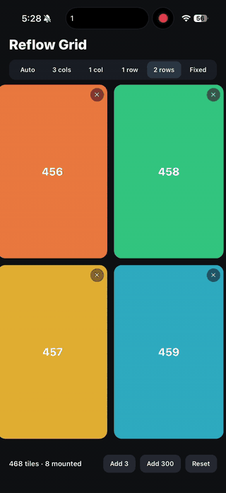

# react-native-reflow-grid

A grid for React Native where **items glide to their new places** when one is added, removed, or the layout changes — like a collection view's delete animation — while **only the items on screen are mounted**.

- **Windowed.** Off-screen items exist only as slots in the layout; just what's visible (plus a buffer) is mounted.
- **Animated reflow.** Remove an item and it shrinks away while the rest spring into the gap. Change the layout (3 columns → 1, vertical → horizontal) and everything glides.
- **Pluggable layouts.** A layout is just `(count, container) => { rects, size }`. `gridLayout` covers grids, lists and strips; write your own for masonry or anything else.
- **Reliable multi-touch.** Presses are decided by the grid, not by per-item `Pressable`, so a second finger's tap isn't dropped while another finger holds the responder.
- Vertical, horizontal, or two-axis scrolling. iOS, Android and web.

Built on `react-native-reanimated` v4 and `react-native-worklets`. Pure TypeScript — no native code.

## Demo

| Columns | Rows |
| --- | --- |
|  |  |

## Install

```sh
npm install react-native-reflow-grid react-native-reanimated react-native-worklets
```

## Usage

```tsx
import { gridLayout, ReflowGrid } from 'react-native-reflow-grid';

const layout = useMemo(() => gridLayout({ flow: 'vertical', lines: 3, gap: 12 }), []);

<ReflowGrid
  style={{ flex: 1 }}
  data={items}
  layout={layout}
  keyExtractor={(item) => item.id}
  renderItem={(item) => <Tile item={item} />}
  touchRegions={(item, { size }) => [
    { key: 'remove', rect: { x: size.width - 40, y: 0, width: 40, height: 40 }, onPress: () => remove(item.id) },
  ]}
/>
```

`renderItem` draws; it takes no touches. Pressable parts are declared in `touchRegions` (in the item's own space), and the grid fires `onPress` when a finger that went down inside one lifts without having moved.

Memoize `layout` and `touchRegions`: a new function lays everything out again.

### `gridLayout(options)`

| Option | Description |
| --- | --- |
| `flow` | `'vertical'` fills a row, then the next below. `'horizontal'` fills a column, then the next beside it. |
| `lines` | Columns (vertical flow) or rows (horizontal). |
| `gap` | A number, or `{ x, y }`. Default `0`. |
| `card` | `{ aspect }` (width ÷ height, default `0.75`), `{ length }` (fixed along the scroll axis), or `{ width, height }` (fixed on both; the grid then scrolls on both axes). |

### `<ReflowGrid>` props

| Prop | Description |
| --- | --- |
| `data`, `keyExtractor`, `renderItem` | As in a list. Keys decide who stays, enters and leaves. |
| `layout` | A `ReflowLayout`. |
| `touchRegions` | Pressable parts of an item. |
| `axis` | `'vertical'` (default), `'horizontal'`, or `'both'`. |
| `startInset`, `endInset` | Space the scrolled content must clear at the start/end of the scroll axis (e.g. a header and a tab bar). Content scrolls beneath and rests clear. Default `0`. |
| `crossStartInset`, `crossEndInset` | For horizontal grids: space rows clear at the top and bottom. |
| `onMounted` | Called with how many cells are mounted after each change. |

### Custom layouts

```ts
import type { ReflowLayout } from 'react-native-reflow-grid';

const stack: ReflowLayout = (count, container) => ({
  rects: Array.from({ length: count }, (_, i) => ({ x: 0, y: i * 60, width: container.width, height: 56 })),
  size: { width: container.width, height: count * 60 },
});
```

## Example

A runnable Expo app in [`example/`](example): switch between 3 columns, a list, one or two rows, and a fixed-size two-axis grid; add or remove tiles (tap the ✕, with as many fingers as you like); add 300 and watch the mounted count stay small.

```sh
cd example
npm install
npx expo install --fix
npx expo run:ios   # or run:android — reanimated needs a dev build, not Expo Go
```

## Roadmap

- **Drag to reorder**, modeled on `UICollectionView`'s interactive movement: press and hold an item to lift it, drag it, and the others glide aside to make room; drop it and the new order is reported back (the grid stays controlled — you update `data`). Planned: auto-scroll near the edges, a drag handle as an alternative to long-press, and per-item opt-out (like `canMoveItemAt`).

## License

MIT
