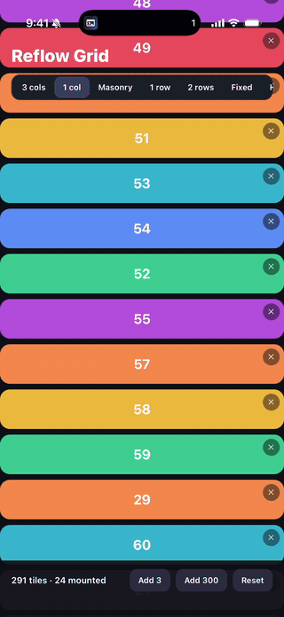
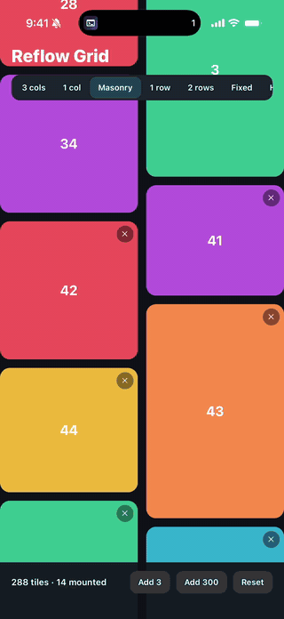

# Drag to reorder

Back to the [README](../README.md).

Drag to reorder, across arrangements:

| 3 columns | 1 column | Masonry |
| --- | --- | --- |
|  |  |  |

| Vertical paging | Horizontal paging |
| --- | --- |
|  |  |

Pass `onReorder` to turn it on. The grid stays controlled: it shows the new order while the item is dragged and after the drop, and you put `data` in that order.

```tsx
<ReflowGrid
  data={items}
  layout={layout}
  keyExtractor={(item) => item.id}
  renderItem={(item, { dragging }) => <Tile item={item} lifted={dragging} />}
  onReorder={({ keys }) => setItems((all) => keys.map((k) => all.find((i) => i.id === k)!))}
  canDrag={(item) => !item.pinned}
/>
```

`onReorder` is called on a drop that changed the order, with a `DragResult`: `{ session, keys, moved, from, to }`, the drag, the new order of the keys, the keys that moved, and where the first of them was and now is. `canDrag(item, index)` opts items out, and `onDragStart(session)` is called when a drag begins. A dragged item's `renderItem` gets `dragging: true`.

A drag is a `DragSession`, a list of items rather than a single key:

```ts
interface DragSession {
  origin: 'internal' | 'external';
  items: { key?: string; types: readonly string[]; local?: unknown }[];
}
```

`key` is the item's key in `data` (an item from another grid or app has none), `types` say what it can be read as, and `local` is what a drag inside the app carries; for an item of the grid, the item. Today the grid lifts one internal item at a time, so `items` has one entry. The shape is already the one that dragging several items together, or items from elsewhere, will use, so those can come without changing your callbacks.

- **Input.** On web a mouse drags through the browser's own drag and drop. A finger, on any platform, holds on an item for 350 ms to lift it, and the item then follows the finger. *Touch dragging has so far only been tried in a browser, not on a device.*
- **Reflow.** The others glide aside as the item moves. The finger is hit-tested against the layout the drag began with, with a margin before it moves to the next slot, so the target can't flip under a resting finger.
- **Auto-scroll.** Dragging near an edge of what's on screen scrolls that way, inside `startInset` and `endInset`, so scrolling continues over a pinned header. It speeds up with how near the edge the pointer is and builds up the longer it's held there.
- **Pages.** In a `pagedLayout`, an item held within 28 pt of an edge for 0.7 s turns the page, and must be held again for the next. A target is looked for among the slots of the page the pointer is on. Pages are dense, so dragging can't make a page with a gap in it or an empty one; dropping on the page after the last puts the item at the end.
- **Clipping.** The grid clips at its edges, a lifted item included. With `dragOverflow="visible"` it doesn't while an item is lifted by a finger (and for a moment after the drop, as it settles), so the item can be carried over what's around the grid. What's drawn later is still on top: order the views, or use `zIndex`, so the grid is above what the item should pass over.
- **Haptics.** With [`expo-haptics`](https://docs.expo.dev/versions/latest/sdk/haptics/) installed the grid taps as an item is lifted, moves, and drops (see the `haptics` prop).

## Joining

Dropping an item onto another can combine them, as apps into a folder. It's off unless you give both `joinPolicy` and `onJoin` (with `onReorder`, which turns dragging on).

```tsx
<ReflowGrid
  data={items}
  layout={layout}
  keyExtractor={(item) => item.id}
  onReorder={reorder}
  joinPolicy={(item) => ({ kind: item.kind, accepts: ['photo'] })}
  onJoin={({ dragged, target }) => {
    const album = makeAlbum(target, dragged);
    setItems((all) => combined(all, target, dragged, album));
    return album.id;
  }}
  renderItem={(item, { joinTarget }) => <Tile item={item} highlighted={joinTarget} />}
/>
```

- **Who can join whom.** `joinPolicy(item, info)` says what an item is (`kind`) and which kinds can be dropped onto it (`accepts`). `zone` is where on the item a drop joins it, from its top-left; by default, its middle. It's asked during a drag, so keep it cheap.
- **Covering.** With the finger in an item's zone nothing makes room, and the item is the `joinTarget` at once: draw it so (darken it, say). A drop then joins. Held there longer it can open (below).
- **Reordering still works**, and at once. Outside the zone, on the near side of an item (the side the dragged one is on), the others make room up to it and it stays where it is, so it can still be moved onto. Past its zone, on the far side, the dragged one takes its slot. Near and far are left and right in a grid, above and below in a list.
- **The drop.** `onJoin({ session, dragged, target })` is where you change `data`: take the dragged item out, and it's seen to go into the target and shrink; update the target. If the two become an item with a new key, return that key: it takes the target's place with no animation of one leaving and another arriving. Return `false` to refuse. `onReorder` isn't called for a join.

## Opening under a drag

Held on a `joinTarget` for 0.9 s, a drag can open it, as a folder, and go on inside. Put a `<ReflowDragProvider>` around the grid and whatever opens over it.

```tsx
<ReflowDragProvider>
  <ReflowGrid
    {...joiningProps}
    onSpringLoad={({ dragged, target }) => {
      moveInto(target, dragged); // change `data`
      open(target);
    }}
  />
  {opened ? <ReflowGrid data={opened.items} onReorder={reorderInside} continuesDrag={shownInFull} /* … */ /> : null}
</ReflowDragProvider>
```

- `onSpringLoad` moves the dragged item into the target and shows it. Return `false` to open nothing; return the key of what's now in the target's place if that changed.
- The grid with `continuesDrag` takes over when it has the item in its `data`: it makes room under the finger, and its `onReorder` reports a drop in a new place. Set `continuesDrag` once the grid is where it will stay, not while it's growing there.
- From the opening to the drop the item is drawn by the provider, above everything in it, with the first grid's `renderItem`.
- The touch stays with the first grid, so **keep it mounted** until the drop.
- A finger only, not a mouse.

## Dragging out of a grid

A drag held outside a grid (`dragExitDelay`, 0.45 s by default) can leave it, as an app leaves an open folder.

```tsx
<ReflowDragProvider onDragEnd={removeHiddenGrids}>
  <ReflowGrid data={pages} continuesDrag={!opened} /* … */ />
  {opened ? <ReflowGrid data={opened.items} onDragExit={({ dragged }) => moveOut(opened, dragged)} /* … */ /> : null}
</ReflowDragProvider>
```

- `onDragExit` moves the dragged item to the other grid's `data` (and puts this one away, if it's a folder). Return `false` to keep the drag.
- **Two grids side by side**, as pages and a dock, exchange items the same way: give both `onDragExit` and `continuesDrag`, check that `point` (the finger, on screen) is over the other grid, and shorten `dragExitDelay`.
- The grid with `continuesDrag` that has the item takes over, and reports the drop.
- **A grid with no room** can still be joined onto: leave the item where it is in `data` when you're asked (don't return `false`), and give the full grid `continuesDrag="join"` meanwhile. Nothing in it makes room; covering, opening and joining work, and its `onJoin` or `onSpringLoad` moves the item. Leaving it again (`onDragExit`) hands the drag back to the grid that has the item.
- **Don't unmount the grid that was left** before the provider's `onDragEnd`, if the drag began in it: the touch is still its, and unmounting ends the drag. Move it out of sight.
- While the finger is outside such a grid, nothing in it makes room, and its edges don't scroll or turn pages.

The logic is plain TypeScript and tested: `src/drag/drag.ts` (the target and the preview order) and `src/drag/dragEngine.ts` (the engine that follows the pointer, scrolls and turns pages, and reports the drop). Input comes from adapters, so another can be added.
