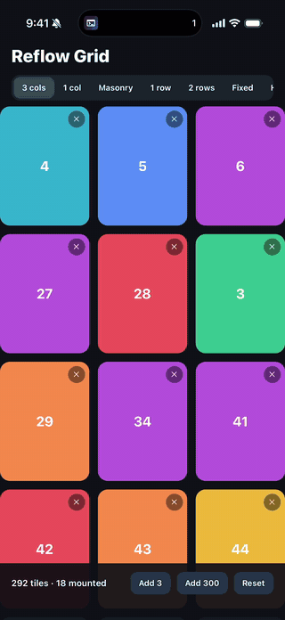
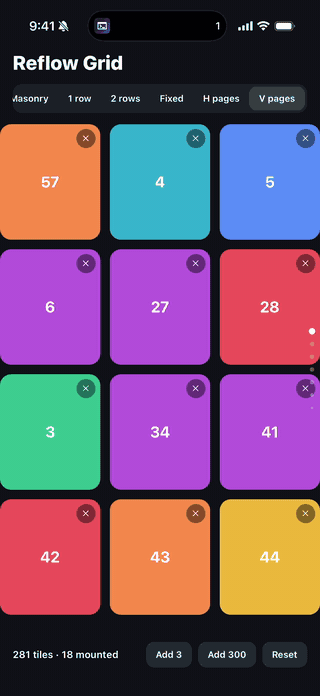
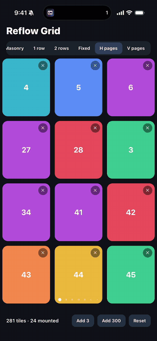

# Drag to reorder

Back to the [README](../README.md).

Drag to reorder, across arrangements:

| 3 columns | 1 column | Masonry |
| --- | --- | --- |
|  |  |  |

| Vertical paging | Horizontal paging |
| --- | --- |
|  |  |

Pass `onReorder` to turn it on. The grid stays controlled: it shows the new order while the item is dragged and after the drop, and you put `data` in that order.

```tsx
<ReflowGrid
  data={items}
  layout={layout}
  keyExtractor={(item) => item.id}
  renderItem={(item, { dragging }) => <Tile item={item} lifted={dragging} />}
  onReorder={({ keys }) => setItems((all) => keys.map((k) => all.find((i) => i.id === k)!))}
  canDrag={(item) => !item.pinned}
/>
```

`onReorder` is called on a drop that changed the order, with a `DragResult`: `{ session, keys, moved, from, to }`, the drag, the new order of the keys, the keys that moved, and where the first of them was and now is. `canDrag(item, index)` opts items out, and `onDragStart(session)` is called when a drag begins. A dragged item's `renderItem` gets `dragging: true`.

A drag is a `DragSession`, a list of items rather than a single key:

```ts
interface DragSession {
  origin: 'internal' | 'external';
  items: { key?: string; types: readonly string[]; local?: unknown }[];
}
```

`key` is the item's key in `data` (an item from another grid or app has none), `types` say what it can be read as, and `local` is what a drag inside the app carries; for an item of the grid, the item. Today the grid lifts one internal item at a time, so `items` has one entry. The shape is already the one that dragging several items together, or items from elsewhere, will use, so those can come without changing your callbacks.

- **Input.** On web a mouse drags through the browser's own drag and drop. A finger, on any platform, holds on an item for 350 ms to lift it, and the item then follows the finger. *Touch dragging has so far only been tried in a browser, not on a device.*
- **Reflow.** The others glide aside as the item moves. The finger is hit-tested against the layout the drag began with, with a margin before it moves to the next slot, so the target can't flip under a resting finger.
- **Auto-scroll.** Dragging near an edge of what's on screen scrolls that way, inside `startInset` and `endInset`, so scrolling continues over a pinned header. It speeds up with how near the edge the pointer is and builds up the longer it's held there.
- **Pages.** In a `pagedLayout`, an item held at an edge for 0.7 s turns the page, and must be held again for the next. A target is looked for among the slots of the page the pointer is on. Pages are dense, so dragging can't make a page with a gap in it or an empty one; dropping on the page after the last puts the item at the end.
- **Haptics.** With [`expo-haptics`](https://docs.expo.dev/versions/latest/sdk/haptics/) installed the grid taps as an item is lifted, moves, and drops (see the `haptics` prop).

The logic is plain TypeScript and tested: `src/drag/drag.ts` (the target and the preview order) and `src/drag/dragEngine.ts` (the engine that follows the pointer, scrolls and turns pages, and reports the drop). Input comes from adapters, so another can be added.
