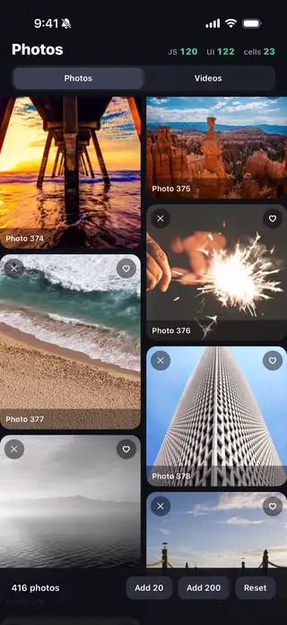

# Photos

Real content in the grid: remote photos, and a grid of playing videos.

| Photos | Videos |
| --- | --- |
|  |  |

- **Photos tab.** A masonry grid in 2 to 4 columns, or 2 to 4 rows that scroll sideways (`masonryLayout`, with `flow: 'horizontal'` for rows). Like and remove are `touchRegions`, a swipe removes a photo, and a drag reorders.
- **Videos tab.** A grid of playing clips, with the number of live players shown as the cells mounted.
- **Loading under a fast scroll.** A cell holds back drawing its photo until it has kept it for a moment (`settleDelay`), and shows the card in the photo's colour meanwhile (`renderPlaceholder`), so dragging the scroll bar doesn't start a download for every card that flies past. The demo cycles through a small pool of photos and prefetches them in one batch, so a photo seen again is a cache hit.
- **Meter and logs.** The header shows the JS and UI frame rates and the cells mounted. With the logs on, Metro prints what became of each photo's download (`[photo]`) and the grid's render timings (`[reflow]`).

It adds `expo-image` and `expo-video`.

## Run it

```sh
npm install
npx expo install --fix
npx expo run:ios   # or run:android: reanimated needs a dev build, not Expo Go
```
