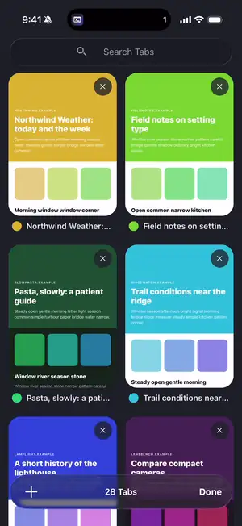
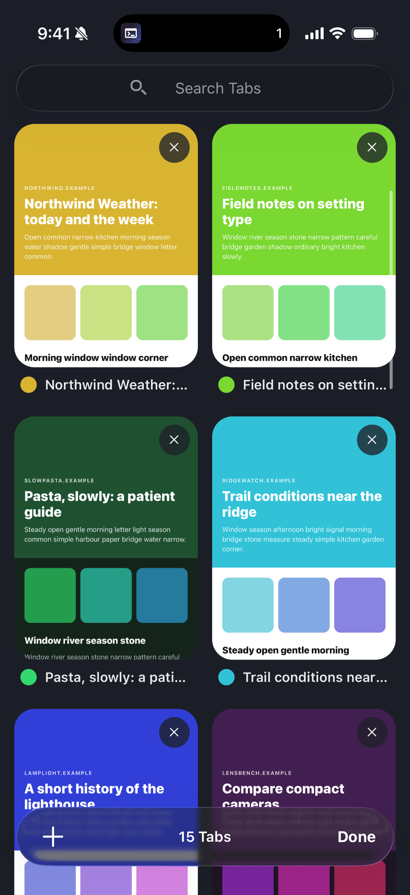
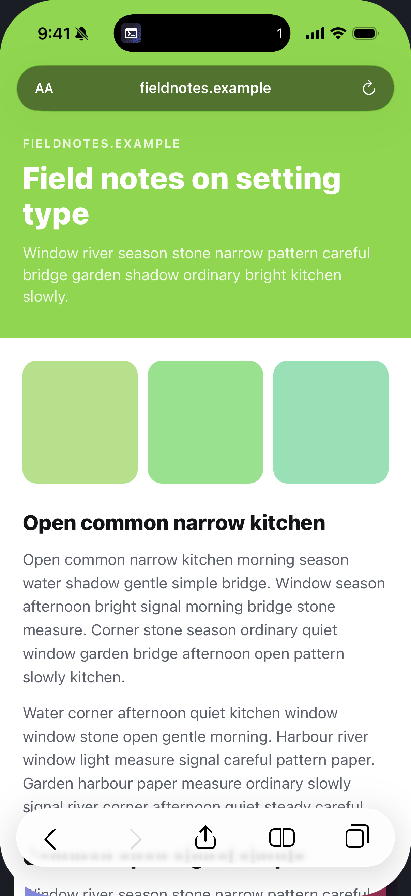

# Safari

Safari's tab overview, built on the grid.

| Demo | Overview | Full screen |
| --- | --- | --- |
|  |  |  |

- **The cards.** A two-column grid of tabs. Each card is a made-up page laid out at screen size and scaled down, with its title below. Tap the ✕ or swipe a card left to close the tab; hold and drag to reorder; search filters them.
- **Opening a tab.** Tap a card and its page grows from the card to fill the screen (a timed ease, its corner radius going to the screen's). The tabs button in the page's toolbar shrinks it back into its card, and Done reopens the last tab.
- **Scroll position.** A page keeps where it was scrolled to: its card shows it there, and it opens there again.
- **The bars.** Glass (`expo-glass-effect`, iOS 26; a plain translucent bar elsewhere). On an open page, scrolling down narrows the address pill to fit the domain and slides the toolbar away; scrolling up brings them back. The address is a real field, and share opens the share sheet.

The cards take no touches of their own (the grid handles tap, drag and swipe), and the open page is an overlay outside the grid, so its content is the app's. See the [main README](../../README.md) for the grid's props.

It adds `expo-glass-effect`.

## Run it

```sh
npm install
npx expo install --fix
npx expo run:ios   # or run:android: reanimated needs a dev build, not Expo Go
```
